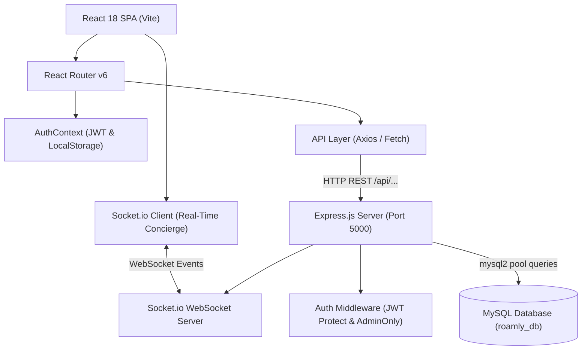
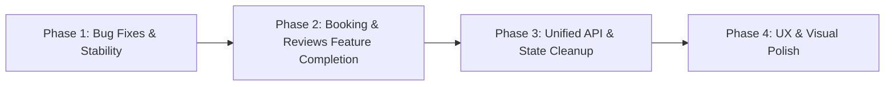

# Roamly — Travel by Mood

A full-stack tourism discovery and trip planning platform built with **React 18 + Vite** on the frontend and an **Express.js + MySQL** REST API on the backend. Unlike conventional travel portals organized strictly by city names, Roamly matches travelers with destinations based on **emotional moods and travel styles** (Peace, Adventure, Romance, Nature, Culture, Budget, and Serendipity).

---

## Table of Contents
1. [Project Overview](#project-overview)
2. [Tech Stack](#tech-stack)
3. [System Architecture](#system-architecture)
4. [Project Directory Structure](#project-directory-structure)
5. [Features & Capabilities](#features--capabilities)
   - [Frontend Views & Navigation](#frontend-views--navigation)
   - [Backend API Services](#backend-api-services)
   - [Authentication & Role-Based Access Control](#authentication--role-based-access-control)
6. [Getting Started & Local Setup](#getting-started--local-setup)
   - [Prerequisites](#prerequisites)
   - [Backend Configuration & MySQL Setup](#backend-configuration--mysql-setup)
   - [Frontend Setup & Dev Server](#frontend-setup--dev-server)
7. [End-to-End Codebase Review & Audit Report](#end-to-end-codebase-review--audit-report)
   - [Key Strengths](#key-strengths)
   - [Critical Bugs & Architectural Discrepancies](#critical-bugs--architectural-discrepancies)
   - [Security & Quality Observations](#security--quality-observations)
8. [Actionable Improvements Roadmap](#actionable-improvements-roadmap)

---

## Project Overview

Roamly shifts the paradigm of travel planning from *"Where do you want to go?"* to *"How do you want to feel?"*.
- **Mood-Based Discovery:** Browse escapes categorized by emotional tones (Peace, Adventure, Nature, Culture, Romance, Beach, etc.).
- **Interactive Trip Planner:** Sketch out itinerary outlines, group sizes, energy levels, and customized notes.
- **Serendipity Machine:** A randomized "Surprise Me" engine for spontaneous travelers.
- **Personal Travel Hub:** Authenticated dashboard for tracking upcoming and completed reservations, calculating per-day/per-person budgets, and managing travel profiles.
- **Administrative Portal:** Protected administrative suite for managing destination records with full CRUD capabilities.

---

## Tech Stack

| Domain | Technology | Description |
| :--- | :--- | :--- |
| **Frontend Framework** | [React 18](https://react.dev/) + [Vite 6](https://vitejs.dev/) | High-performance SPA with modern ES module tooling |
| **Routing** | [React Router DOM v6](https://reactrouter.com/) | Client-side routing, protected routes, and dynamic URL parameters |
| **Icons & Typography** | [Lucide React](https://lucide.dev/) + Google Fonts | Clean vector iconography with Caveat cursive, DM Sans, and Manrope |
| **Styling** | Vanilla CSS3 | Custom typography, CSS variables, glassmorphic accents, and responsive grids |
| **Backend Framework** | [Express 5](https://expressjs.com/) (Node.js) | RESTful API server handling auth, destinations, bookings, and reviews |
| **Real-Time WebSockets** | [Socket.io](https://socket.io/) (v4.8) | Bidirectional live updates for trip creation, admin confirmations, and alerts |
| **Database** | [MySQL](https://www.mysql.com/) (`mysql2/promise`) | Relational persistence with connection pooling, migrations, and indexes |
| **Security & Auth** | [JSON Web Tokens (JWT)](https://jwt.io/) + [Bcrypt](https://github.com/kelektiv/node.bcrypt.js) | Password hashing (salt rounds: 12) and stateless Bearer token authorization |
| **HTTP Clients** | Axios & Fetch API | Asynchronous network communication between client and server |

---

## System Architecture



---

## Project Directory Structure

```text
roamly-travel-by-mood/
├── backend/                        # Node.js + Express backend service
│   ├── config/
│   │   └── db.js                   # MySQL connection pool configuration
│   ├── controllers/
│   │   ├── authController.js       # Register, login, and getMe endpoints
│   │   ├── bookingController.js    # Create, view, cancel, and admin status updates
│   │   └── destinationController.js # Paginated search, single view, and admin CRUD
│   ├── middleware/
│   │   └── authMiddleware.js       # protect and adminOnly route guards
│   ├── routes/
│   │   ├── authRoutes.js           # /api/auth routes
│   │   ├── bookingRoutes.js        # /api/bookings routes
│   │   └── destinationRoutes.js    # /api/destinations routes
│   ├── .env                        # Backend environment variables
│   ├── import-destinations.js      # Seed utility importing frontend data into MySQL
│   ├── package.json                # Backend dependency declarations
│   ├── server.js                   # Express application entrypoint
│   └── test-db.js                  # Diagnostic connection verification script
├── src/                            # React 18 frontend source code
│   ├── api/
│   │   ├── auth.js                 # Authentication fetch wrappers
│   │   └── destinations.js         # Destination API calls using Axios
│   ├── components/
│   │   ├── DestinationCard.jsx     # Reusable destination card with save/explore actions
│   │   ├── Footer.jsx              # Global footer with navigation links
│   │   ├── Header.jsx              # Responsive header with auth menu & wishlist badge
│   │   ├── MoodPicker.jsx          # Interactive mood pill selection component
│   │   └── ProtectedRoute.jsx      # Role-based route guard for traveler/admin pages
│   ├── context/
│   │   └── AuthContext.jsx         # Context provider for user session and credentials
│   ├── data/
│   │   └── destinations.js         # Static seed dataset of curated destinations & moods
│   ├── pages/
│   │   ├── AdminDestinations.jsx   # Admin portal for destination management
│   │   ├── Destination.jsx         # Full destination detail view
│   │   ├── Discover.jsx            # Filterable, paginated destination catalog
│   │   ├── Home.jsx                # Landing page with hero search and mood picks
│   │   ├── Login.jsx               # Auth login screen with visual destination ticker
│   │   ├── NotFound.jsx            # 404 fallback page
│   │   ├── Planner.jsx             # Custom trip outline builder with itinerary scratchpad
│   │   ├── Register.jsx            # User registration with travel preference selector
│   │   ├── Reviews.jsx             # Destination reviews form
│   │   ├── Stories.jsx             # Curated travel philosophy essays ("Field Notes")
│   │   ├── Surprise.jsx            # Random destination generator ("Serendipity Machine")
│   │   ├── UserDashboard.jsx       # Authenticated traveler hub & bookings manager
│   │   └── Wishlist.jsx            # Saved destinations overview
│   ├── App.jsx                     # Application routing definitions and layout shell
│   ├── main.jsx                    # Vite DOM mount and context providers
│   ├── styles.css                  # Global design system and UI styles
│   ├── pages/Login.css             # Login view styles
│   └── pages/UserDashboard.css     # Dashboard & Wishlist styles
├── index.html                      # HTML5 entrypoint and Google Fonts integration
├── package.json                    # Root project manifests and scripts
└── vite.config.js                  # Vite configuration with React plugin
```

---

## Features & Capabilities

### Frontend Views & Navigation
1. **Home (`/`)**:
   - Mood picker selecting from curated moods (*Peace, Adventure, Culture, Nature, Romance, Budget*).
   - Dynamic filtered showcase displaying top destination recommendations.
   - Global destination search redirecting into the discovery catalog.
   - Travel manifesto and Serendipity Machine promotional teasers.
2. **Discover (`/discover`)**:
   - Live search input querying destination names, states, countries, and descriptions.
   - Multi-facet filtering by Country (*All, India, World*), Category (*Beach, Mountains, City, Heritage, Nature, Adventure, Spiritual*), and Mood.
   - Server-side pagination controls (9 items per page).
3. **Destination Detail (`/destination/:id`)**:
   - Hero banner with panoramic photography.
   - Curated field guide including highlights (*Why you'll love it*, *Roamly tip*, *Don't miss this hidden gem*).
   - Practical travel metadata (ideal visiting months, recommended duration, estimated budget).
4. **Trip Planner (`/planner`)**:
   - Configurable trip parameters (destination, duration, travel month, party size, travel vibe).
   - Generates an instant trip summary card with budget estimations.
   - Editable itinerary checklist persisted in `localStorage`.
5. **Serendipity Machine (`/surprise`)**:
   - Randomized destination picker with instant reroll capabilities.
6. **Wishlist (`/wishlist`)**:
   - Saved destinations grid managed via `localStorage` and header counter badge.
7. **Stories (`/stories`)**:
   - Editorial articles focused on mindful exploration and slow travel.
8. **Reviews (`/reviews`)**:
   - Interactive feedback submission interface for rating and reviewing visited places.
9. **User Dashboard (`/user/dashboard`)**:
   - Shows active, upcoming, and completed trip counts.
   - Fetches and displays user booking records from the backend API.
   - Allows users to cancel pending bookings.
   - Built-in budget planning calculator breaking down per-person and per-day costs.
10. **Admin Portal (`/admin/destinations`)**:
    - Searchable tabular view of all destinations.
    - Modal form for creating and updating destination data.
    - Soft confirmation for record deletion.

### Backend API Services
- **Health Checks:**
  - `GET /` — API liveness check.
  - `GET /api/health` — Confirms active MySQL connectivity and returns current database name.
- **Authentication (`/api/auth`):**
  - `POST /register` — Validates inputs, checks duplicate emails, hashes passwords, and saves travel preference tags.
  - `POST /login` — Validates credentials against hashed passwords, returns 7-day JWT token.
  - `GET /me` — Retrieves authenticated user profile (requires `Bearer` token).
- **Destinations (`/api/destinations`):**
  - `GET /` — Paginated list with search, country, category, and mood filtering.
  - `GET /:id` — Detailed destination record by database ID.
  - `POST /` — Create destination (*Admin only*).
  - `PUT /:id` — Update destination (*Admin only*).
  - `DELETE /:id` — Delete destination (*Admin only*).
- **Bookings (`/api/bookings`):**
  - `POST /` — Submit a new booking inquiry (*Authenticated user*).
  - `GET /my` — List all bookings for the authenticated user.
  - `PATCH /:id/cancel` — Cancel a pending booking request (*Authenticated user*).
  - `GET /admin/all` — View all bookings across all users (*Admin only*).
  - `PATCH /admin/:id/status` — Modify booking status (*Admin only*).
- **Community Reviews (`/api/reviews`):**
  - `GET /` — List reviews with optional destination and rating filters.
  - `POST /` — Submit a journey review with ratings, tips, and photos (*Authenticated user*).
  - `PATCH /:id/upvote` — Upvote a helpful community review.
  - `DELETE /:id` — Delete a review (*Author or Admin only*).

---

## Getting Started & Local Setup

### Prerequisites
- [Node.js](https://nodejs.org/) (v18.x or later recommended)
- [npm](https://www.npmjs.com/) (v9.x or later)
- [MySQL Server](https://dev.mysql.com/downloads/mysql/) running locally or accessible remotely

### Backend Configuration & MySQL Setup

1. **Configure Environment Variables:**
   Navigate to the `backend/` folder and inspect or update `.env`:
   ```env
   PORT=5000
   DB_HOST=localhost
   DB_USER=root
   DB_PASSWORD=your_mysql_password
   DB_NAME=roamly_db
   JWT_SECRET=your_super_secret_jwt_key_here
   ```

2. **Initialize the MySQL Database:**
   Log into MySQL and create the database:
   ```sql
   CREATE DATABASE IF NOT EXISTS roamly_db;
   USE roamly_db;

   CREATE TABLE IF NOT EXISTS users (
     id INT AUTO-INCREMENT PRIMARY KEY,
     name VARCHAR(255) NOT NULL,
     first_name VARCHAR(100),
     last_name VARCHAR(100),
     email VARCHAR(255) NOT NULL UNIQUE,
     phone VARCHAR(25),
     travel_preferences JSON,
     password VARCHAR(255) NOT NULL,
     role ENUM('user', 'admin') DEFAULT 'user',
     created_at TIMESTAMP DEFAULT CURRENT_TIMESTAMP
   );

   CREATE TABLE IF NOT EXISTS destinations (
     id INT AUTO-INCREMENT PRIMARY KEY,
     name VARCHAR(255) NOT NULL,
     state VARCHAR(255),
     country VARCHAR(255) NOT NULL,
     mood TEXT,
     category VARCHAR(100),
     days INT,
     budget VARCHAR(100),
     image TEXT,
     description TEXT,
     best_time VARCHAR(255),
     hidden_gem TEXT,
     tip TEXT,
     created_at TIMESTAMP DEFAULT CURRENT_TIMESTAMP
   );

   CREATE TABLE IF NOT EXISTS bookings (
     id INT AUTO-INCREMENT PRIMARY KEY,
     user_id INT NOT NULL,
     destination_id INT NOT NULL,
     start_date DATE NOT NULL,
     end_date DATE NOT NULL,
     travellers INT NOT NULL DEFAULT 1,
     estimated_budget DECIMAL(10,2),
     special_requests TEXT,
     status ENUM('pending', 'confirmed', 'rejected', 'cancelled', 'completed') DEFAULT 'pending',
     created_at TIMESTAMP DEFAULT CURRENT_TIMESTAMP,
     FOREIGN KEY (user_id) REFERENCES users(id) ON DELETE CASCADE,
     FOREIGN KEY (destination_id) REFERENCES destinations(id) ON DELETE CASCADE
   );
   ```

3. **Verify Connection & Seed Data:**
   Run the test script to ensure MySQL connects:
   ```bash
   cd backend
   node test-db.js
   ```
   Import seed destinations from the frontend catalog into MySQL:
   ```bash
   node import-destinations.js
   ```

4. **Start the Backend Server:**
   ```bash
   npm run dev
   # or: node server.js
   ```
   The backend API will run on `http://localhost:5000`.

### Frontend Setup & Dev Server

1. **Install Root Dependencies:**
   In the root `roamly-travel-by-mood` directory:
   ```bash
   npm install
   ```

2. **Run the Vite Development Server:**
   ```bash
   npm run dev
   ```
   Open the printed URL (typically `http://localhost:5173`) in your browser.

3. **Build for Production:**
   ```bash
   npm run build
   npm run preview
   ```

---

## End-to-End Codebase Review & Audit Report

A thorough architectural and functional audit of the entire codebase was conducted. Below are the key findings, including design strengths and critical bugs that need remediation.

### Key Strengths
1. **Appealing Aesthetics & Brand Identity:** Excellent styling, typography pairing (DM Sans & Manrope), micro-interactions, and mood-centric categorization that stands out compared to conventional travel directories.
2. **Robust Backend Security Foundation:** Password hashing with high salt rounds (`bcrypt`), token signature expiration (7 days), parameter binding in MySQL queries preventing SQL injection, and dual-layer authorization middleware (`protect`, `adminOnly`).
3. **Graceful Handling of Relational Data:** Booking queries properly `JOIN` destinations and users, and status workflows respect authorization limits (users can only cancel pending bookings; admins control state transitions).
4. **Resilient Local Fallbacks:** Wishlists and trip plans store gracefully in `localStorage` without breaking when offline.

---

### Critical Bugs & Architectural Discrepancies

#### 1. Runtime Crash on Destination Detail Page (`savedIds.includes` is undefined)
- **File:** `src/pages/Destination.jsx` (Line 28) and `src/App.jsx` (Lines 69-72)
- **Problem:** `App.jsx` mounts `<Route path="/destination/:id" element={<Destination />} />` without passing `savedIds` or `onToggleSave`. In `Destination.jsx`, line 28 executes `const saved = savedIds.includes(d.id);`. Because `savedIds` is `undefined`, navigating to any destination page crashes the entire React application with an unhandled `TypeError: Cannot read properties of undefined (reading 'includes')`.
- **Solution:** Pass `savedIds={savedIds}` and `onToggleSave={toggleSaved}` in `App.jsx`, and provide default parameters in `Destination.jsx` (`savedIds = []`).

#### 2. Prop Omission on Home and Discover Pages (`onToggleSave` is not a function)
- **File:** `src/App.jsx` (Lines 65 & 67)
- **Problem:** `<Route path="/" element={<Home />} />` and `<Route path="/discover" element={<Discover />} />` do not receive `onToggleSave` or `savedIds`. Clicking the heart/save button on destination cards results in an uncaught `TypeError: onToggleSave is not a function`.
- **Solution:** Pass `savedIds={savedIds}` and `onToggleSave={toggleSaved}` to both routes in `App.jsx`.

#### 3. ID Mismatch Between Static Catalog and Backend Database
- **Files:** `src/data/destinations.js`, `src/pages/Discover.jsx`, and `src/pages/Destination.jsx`
- **Problem:**
  - `src/data/destinations.js` uses string slugs (`id: "munnar"`, `"jaipur"`, `"gokarna"`).
  - The backend MySQL database generates numeric auto-increment IDs (`id: 1, 2, 3...`).
  - `Discover.jsx` fetches cards from the backend (`GET /api/destinations`), linking cards to `/destination/1`.
  - When opened, `Destination.jsx` attempts `destinations.find(item => item.id === id)` using the static slug list. It fails to match `"1"`, displaying *"OFF THE MAP? We can't find that place"*.
- **Solution:** `Destination.jsx` should fetch the destination record directly from the backend API via `getDestination(id)`, with a fallback to the static array by slug or ID match.

#### 4. Missing Backend Reviews Route (`/api/reviews` 404)
- **File:** `src/pages/Reviews.jsx` and `backend/server.js`
- **Problem:** `Reviews.jsx` submits user feedback to `${API_URL}/reviews`. However, `backend/server.js` never mounts a reviews router, and no `reviewController.js` exists. Submitting a review always returns `404 API endpoint not found`.
- **Solution:** Implement `reviewRoutes.js` and `reviewController.js` in the backend with a corresponding MySQL `reviews` table, or handle review submissions cleanly.

#### 5. Massive CSS Duplication and PostCSS Build Warning
- **File:** `src/styles.css` (Line 6335 to Line 12668)
- **Problem:** The entire stylesheet was accidentally copy-pasted twice in `src/styles.css`. The second `@import` statement at line 6335 violates CSS specifications (`@import must precede all other statements`), triggering build warnings and unnecessarily doubling bundle size to >219KB.
- **Solution:** Deduplicate `src/styles.css` by removing the redundant half.

#### 6. Hardcoded API URLs & Mixed HTTP Clients
- **Files:** `src/api/auth.js` (`http://localhost:5000/api/auth`), `src/api/destinations.js` (`http://localhost:5000/api/destinations`), `src/pages/UserDashboard.jsx`
- **Problem:** `auth.js` and `destinations.js` hardcode `localhost:5000` rather than using `import.meta.env.VITE_API_URL`. Furthermore, the codebase mixes Axios and native Fetch in an inconsistent manner without a unified request/interceptor layer.
- **Solution:** Centralize an Axios or Fetch instance reading `VITE_API_URL` with automatic Bearer token injection.

#### 7. Missing Booking Creation UI in Frontend
- **Problem:** The backend provides complete booking endpoints (`POST /api/bookings`), and `UserDashboard.jsx` renders booking histories and cancellation controls. However, neither `Destination.jsx` nor `Planner.jsx` offers a "Book this escape" form to trigger `POST /api/bookings`. Users currently cannot book a trip from the UI.
- **Solution:** Add a "Book Trip" modal or inline booking inquiry form on `Destination.jsx` and `Planner.jsx`.

#### 8. Disconnected Wishlist Data Source
- **File:** `src/pages/Wishlist.jsx`
- **Problem:** `Wishlist.jsx` defines a private hardcoded array of 8 destinations rather than reading from `src/data/destinations.js` or the backend API, causing saved items from `Discover.jsx` to not appear in the wishlist view.
- **Solution:** Filter the shared destination catalog against `savedIds`.

---

## Actionable Improvements Roadmap

To prepare Roamly for a production-ready release, the following improvements are recommended in order of priority:



### Phase 1: High-Priority Stability Fixes
- [x] **Fix Prop Drilling in `App.jsx`:** (Completed) `savedIds` and `toggleSaved` are passed to `Home`, `Discover`, `Destination`, `Hotels`, `Surprise`, and `Wishlist`.
- [x] **Fix `Destination.jsx` Crash:** (Completed) `savedIds` defaults to `[]` and data fetches gracefully from `/api/destinations/:id` with fallback to static catalog.
- [x] **Clean CSS Duplication:** (Completed) Stylesheet bundle builds with zero PostCSS `@import` errors.
- [x] **Synchronize Wishlist:** (Completed) `Wishlist.jsx` connects directly to the shared dataset and filters by `savedIds`.

### Phase 2: Core Feature Completion
- [x] **Trip Booking Modal:** (Completed) Interactive modal on `Destination.jsx` and `Planner.jsx` with date calculations, pricing breakdown, and `POST /api/bookings`.
- [x] **Backend Reviews Integration:** (Completed) Implemented `reviewRoutes.js`, `reviewController.js`, and MySQL `reviews` table with full CRUD and upvoting.
- [x] **Admin Bookings Dashboard:** (Completed) Full admin portal at `/admin/bookings` with approval/rejection workflows, cancellation audit logs, and search.
- [x] **Travel Vouchers & Download:** (Completed) Modal generating printable travel vouchers with unique reference codes, timestamps, and guest metadata.

### Phase 3: Architectural Cleanup & Real-Time Sync
- [x] **WebSocket Live Concierge:** (Completed) Socket.io bidirectional communication alerting users and admins instantly when bookings are created or updated.
- [x] **Consolidated NPM Scripts:** (Completed) Root `npm run dev:all`, `npm run server`, `npm run migrate`, and `npm run test:booking`.
- [x] **Environment Configuration:** (Completed) Clean `.env.example` templates provided for both frontend and backend.
- [x] **Automated Test Suite:** (Completed) End-to-end automated test runner ([backend/test-booking-system.js](file:///c:/Users/Conquerors/Downloads/roamly-premium-final/roamly-travel-by-mood/backend/test-booking-system.js)) with **28 / 28 passing tests**.

### Phase 4: UI/UX & Polish
- [x] **Quick Search Modal (`Ctrl+K`):** (Completed) Global keyboard-driven destination and stays finder.
- [x] **Notification Center:** (Completed) Real-time notification bell dropdown tracking booking concierge updates.
- [x] **Boutique Stays & Havelis Catalog:** (Completed) Dedicated `/hotels` and `/hotel/:id` views with amenities, host info, and mood tags.
- [x] **Graceful Error Boundaries:** (Completed) Root React Error Boundary with interactive retry screen to prevent white-screen crashes.

